# Manual de Usuario — Sistema Inteligente de Optimización de Compras

## Introducción
El **Sistema Inteligente de Optimización de Compras** es una herramienta de soporte a la decisión que ayuda a responder cuatro preguntas: **qué** comprar, **cuánto**, **cuándo** y **a qué proveedor**. El sistema no reemplaza al comprador, sino que le entrega recomendaciones explicables y auditables.

## Acceso al sistema
Para ingresar, abre tu navegador y dirígete a la dirección proporcionada (por ejemplo, `http://localhost:5173`). Verás la pantalla de inicio de sesión.

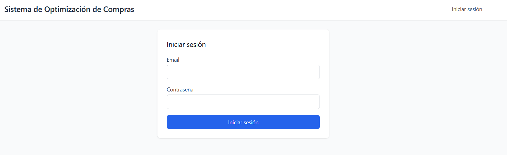

Introduce tus credenciales de administrador y pulsa "Iniciar sesión". La cuenta proporcionada tiene permisos elevados para probar todas las funciones.

## Las vistas del sistema

Una vez dentro, verás una barra de navegación superior que te da acceso a los diferentes módulos.

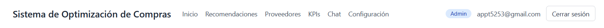

### Inicio
La vista de inicio te da la bienvenida y muestra accesos directos a las tareas más comunes.

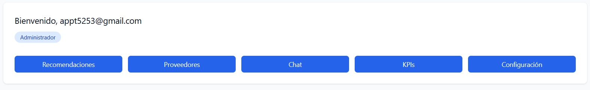

### Cola de Recomendaciones
Es el corazón operativo. Muestra los productos que necesitan reabastecimiento. Puedes filtrar por urgencia (Crítico, Atención, Sin riesgo) y ver el impacto económico de cada decisión.

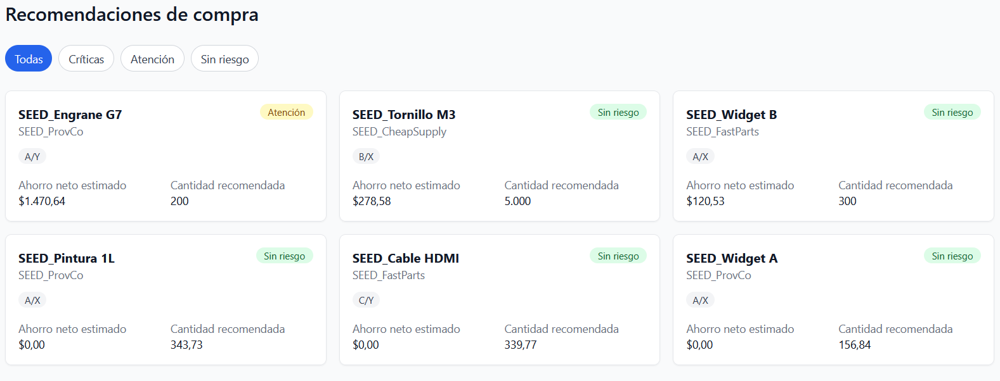

### Panel de Explicabilidad
Al hacer clic en una recomendación, accedes al desglose de los **6 criterios** que el motor evaluó (riesgo, EOQ, confianza, etc.). Es lo que hace que el sistema sea transparente.

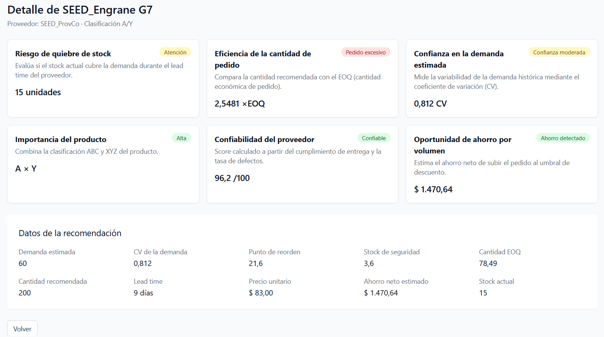

### Proveedores
Muestra el catálogo de proveedores, su *score* calculado (basado en calidad y cumplimiento) y su estado de confiabilidad.

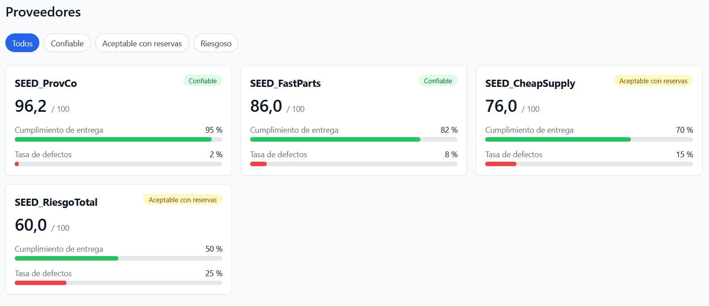

### Chat con el Agente
Puedes hacerle preguntas en lenguaje natural al agente (impulsado por IA). Te responderá basándose en los datos reales del sistema.

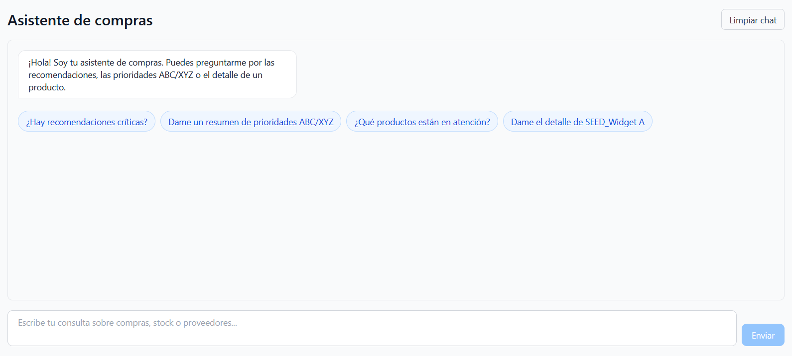

### Panel de KPIs
Una vista ejecutiva con métricas clave: ahorro total, distribución de urgencias y clasificación ABC/XYZ.

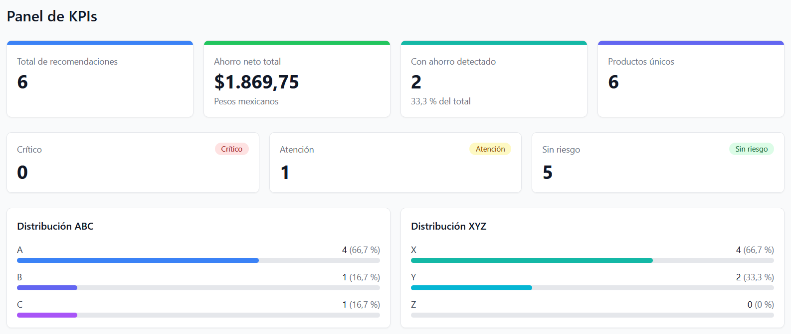

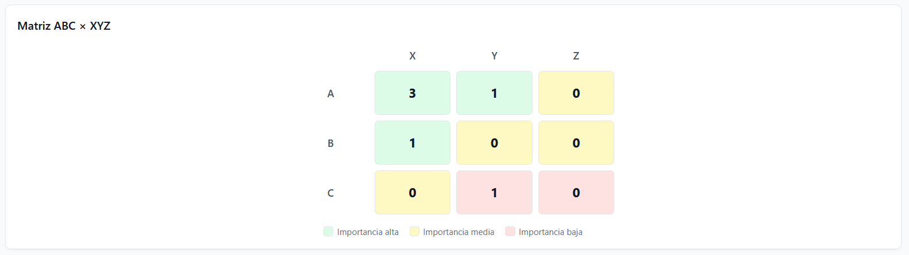

### Configuración (Solo Administradores)
Permite modificar los 10 umbrales del sistema sin tocar código. Además, incluye el botón **Recalcular recomendaciones** para aplicar los cambios.

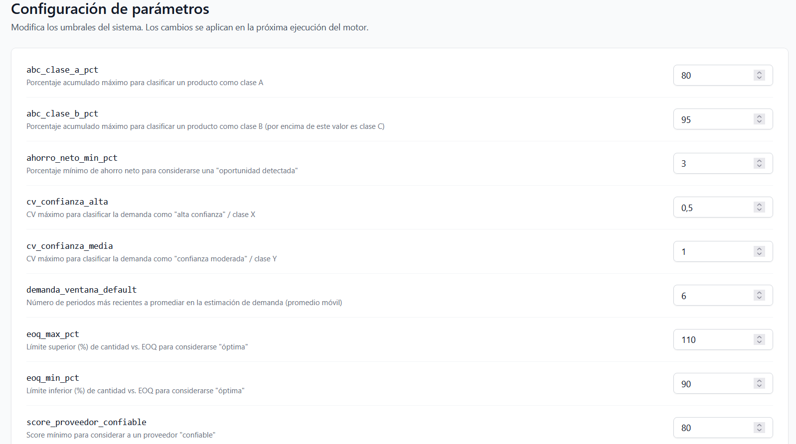

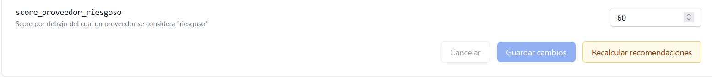

## Flujos típicos de uso

### Actualizar la cola de recomendaciones
1. Ve a **Configuración**.
2. Cambia el valor de un parámetro (por ejemplo, `ahorro_neto_min_pct` de `3` a `10`).
3. Pulsa **Guardar cambios**.
4. Pulsa **Recalcular recomendaciones**. El sistema generará nuevas recomendaciones aplicando la nueva regla.

### Entender una recomendación
1. Ve a la **Cola de Recomendaciones**.
2. Haz clic en cualquier tarjeta.
3. Revisa los **6 criterios** en el Panel de Explicabilidad.

### Consultar al Agente
El Agente conversacional es de solo lectura. Está diseñado para responder preguntas sobre los datos reales del sistema. Algunos ejemplos de lo que le puedes preguntar:

*   **Resumen general:** *"¿Qué debería comprar esta semana?"* o *"Dame un resumen de las recomendaciones por urgencia."*
*   **Detalle de un producto:** *"¿Por qué me recomiendas comprar el Widget A?"* o *"¿Cuál es el punto de reorden del Tornillo M3?"*
*   **Proveedores:** *"¿Qué proveedores ofrecen el Cable HDMI?"* o *"¿Cuál es el score del proveedor FastParts?"*
*   **Filtros:** *"¿Qué productos están en estado Crítico?"*

**Nota:** Si le preguntas por un producto que no existe o por datos que no están en la base de datos, el agente te dirá explícitamente que no cuenta con esa información (no inventa respuestas).

## Glosario
- **ABC**: Clasificación de productos por importancia económica (A es el 80% del valor, C es el 5%).
- **XYZ**: Clasificación por previsibilidad de la demanda (X es estable, Z es errática).
- **EOQ**: Cantidad de pedido óptima (*Economic Order Quantity*).
- **ROP**: Punto de reorden (*Reorder Point*).
- **CV**: Coeficiente de variación (mide qué tan variable es la demanda).
- **Stock de seguridad**: Inventario extra para cubrir picos de demanda.
- **Ahorro neto**: Diferencia a favor al aprovechar un descuento por volumen.
- **Score**: Puntuación de 0 a 100 de un proveedor, basada en su calidad y cumplimiento.